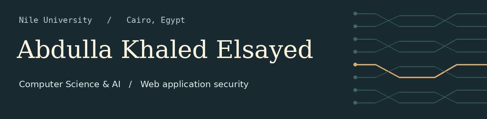

I build APIs and banking middleware simulations. I’m learning web application penetration testing, networking, and Linux, and I’m open to collaborating on Python and API projects.

[Résumé](https://1drv.ms/b/c/17c4abe4de554ebc/IQCeVNFa1NRVRacc6kAHTEowAR56_DujQzPdfPEf-OIFvps?e=Q1rUtn) · [LinkedIn](https://www.linkedin.com/in/abdullakhaled/) · [Email](mailto:abdullakhaledelsaid@gmail.com)

## Selected work

### [Mock Instant Payment Network](https://github.com/Akhaledelsayed/mock-instant-payment-network)

Follow a payment from debit at one mock bank to credit at another. A single transaction ID connects both sides, and duplicate checks protect against debiting the same payment twice.

`IBM App Connect Enterprise` · `IBM MQ` · `SQL Server` · `ESQL`

### [Student & Course API](https://github.com/Akhaledelsayed/panarab-week-4-rest-api-genai-integration)

A Laravel API for student records and course enrollment, with validated requests, paginated JSON responses, and a mock service for academic feedback.

`Laravel` · `Eloquent` · `SQLite`

## Toolbox

**Data science**　Python, Jupyter, NumPy, pandas, scikit-learn  
**Development**　C, Java, Dart, Flutter, PHP, Laravel, CSS, Sass, Sculpin  
**Tools**　Postman, Git, Linux, Docker, MySQL, Figma

[Kaggle](https://www.kaggle.com/abdullakhaledelsayed) · [Instagram](https://www.instagram.com/3bdulla5haled/) · [All repositories](https://github.com/Akhaledelsayed?tab=repositories)
